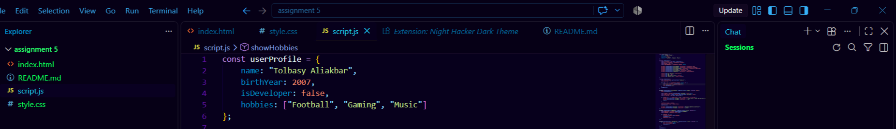
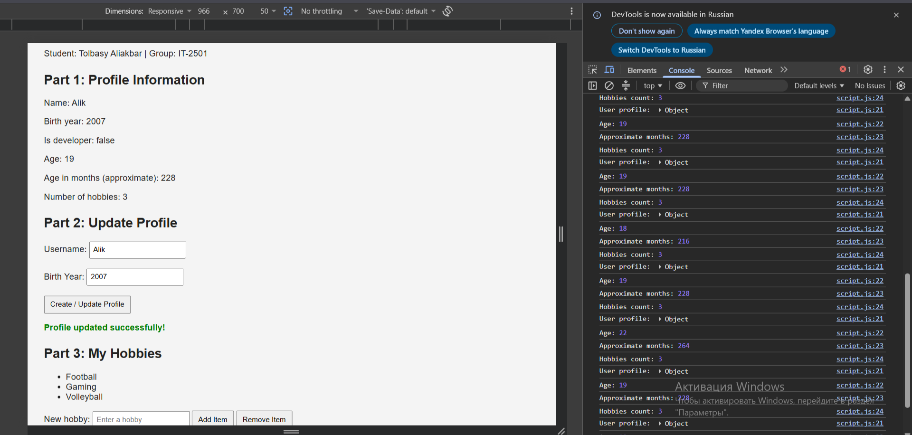
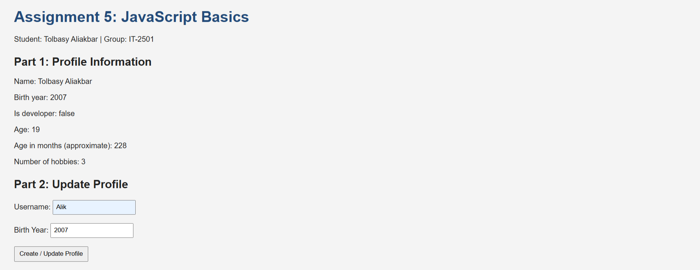
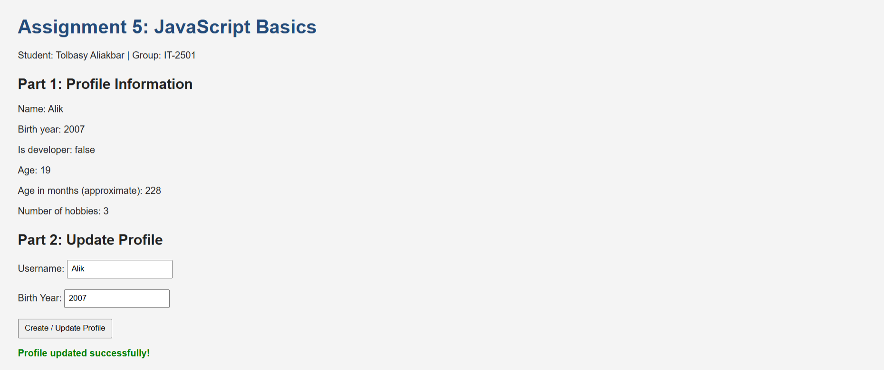
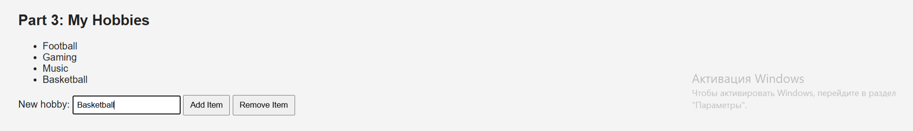
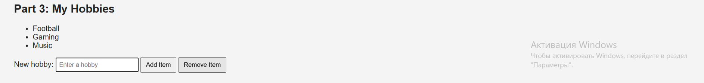

 Assignment 5: JavaScript Basics (DOM Manipulation & Events)

Student: Tolbasy Aliakbar  
Group: IT-2501

## Project Description

This is a simple website made with HTML, CSS, and JavaScript. It shows profile information, allows a user to update their name and birth year, and allows adding and removing hobbies.

## Part 1: Profile Object, Data Types & Arithmetic

### Task 1: The Personal Info Object

I created a `const` object called `userProfile` in `script.js`. It contains a string (`name`), number (`birthYear`), boolean (`isDeveloper`), and array (`hobbies`). The initial birth year is an example value, not confirmed personal information.

### Task 2: Arithmetic Calculations

I used `new Date().getFullYear()` to get the current year. The program subtracts the birth year to calculate age and multiplies age by 12 for approximate months. It also uses `.length` to count hobbies. The results are displayed on the page and in the browser console. The month count is an approximation because only the birth year is known.

## Part 2: Form Input & Event Responses

### Task 3: HTML Form Setup

I made a form with Username and Birth Year inputs and a **Create / Update Profile** button.

### Task 4: Event Listener

I used `addEventListener("submit", ...)` to read the form values, update `userProfile.name` and `userProfile.birthYear`, and show the new information on the page. The page does not reload because I used `event.preventDefault()`.

## Part 3: DOM List Manipulation

### Task 5: Creating & Removing Elements

I created a `<ul>` for hobbies. The Add Item button uses `push()` and `document.createElement("li")` to add a hobby. The Remove Item button uses `pop()` to remove the last hobby. The list is updated with DOM methods.

## Work Process Summary

First, I created the HTML page and the `userProfile` object. Then I added the calculations for age and hobbies. Next, I created the form and wrote a submit event listener. Finally, I added buttons to add or remove hobbies and checked the results in the browser.

## How to Run

1. Open `index.html` in a browser.
2. Edit the name and birth year in the form and press **Create / Update Profile**.
3. Add or remove hobbies using the buttons.
4. Open the browser Developer Tools console to see the calculation output.

## Files

- `index.html` - the web page and form
- `style.css` - basic page styling
- `script.js` - JavaScript object, calculations, events, and DOM changes
- `screenshots/` - screenshots for the assignment tasks

## Submission

Upload all project files to a **public GitHub repository**. Enable **GitHub Pages** for the repository. Submit **both** the repository URL and the GitHub Pages URL in Moodle before the deadline and attend the mandatory practice lesson defense.

**GitHub repository:** Add your link after uploading.  
**GitHub Pages:** Add your link after enabling Pages.
